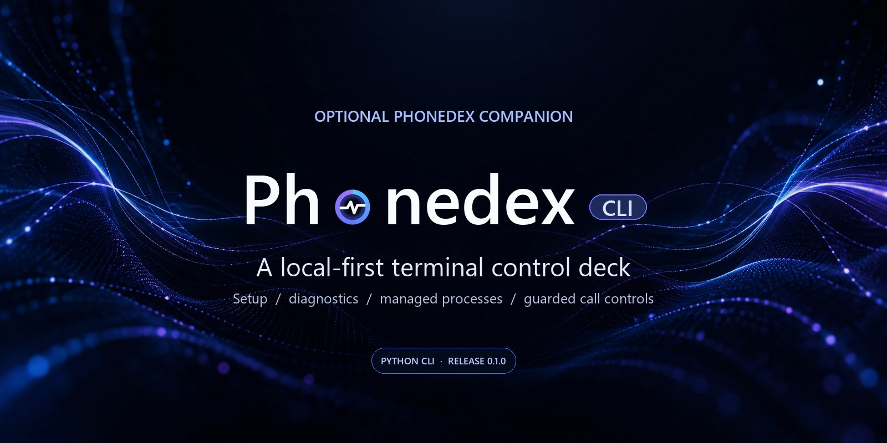

<div align="center">
  
</div>

<h1 align="center">PhoneDex CLI</h1>

<p align="center">
  An optional, local-first terminal interface for setup, diagnostics and guarded control of a PhoneDex installation.<br />
  <strong>It is a separate frontend. The PhoneDex core owns telephony, voice sessions and Worker integrations.</strong>
</p>

<p align="center">
  <a href="https://github.com/dexifried/Phonedex-CLI/actions/workflows/ci.yml"></a>
  <a href="https://pypi.org/project/phonedex-cli/"></a>
  
  <a href="LICENSE"></a>
  
</p>

## What it does

PhoneDex CLI is a [Rich](https://github.com/Textualize/rich)-powered Python control deck for the separate [PhoneDex](https://github.com/dexifried/Phonedex) project. It guides setup, runs the core's read-only readiness checks, edits a small allowlist of non-credential local settings, and manages only a controller process that it started itself.

It does not implement SIP, provision a phone provider, or connect directly to GPT Live. The CLI delegates supported actions to the official commands in a PhoneDex checkout.

## Features

- **Windows-first guided setup:** select or clone the official public PhoneDex checkout, prepare a private Python environment, install missing prerequisites with confirmation, verify Codex login, choose an AgentPhone SIP trunk or other provider, configure Windows networking, and perform diagnostics plus an optional first call.
- **Readiness and status:** display local configuration and inspect the PhoneDex core through its own setup checks and doctor.
- **Scoped controller management:** start, stop, or restart only a controller process registered by this CLI; a start or restart can dispatch work already queued in your Worker.
- **Local privacy settings:** edit transcript mode, local retention, daily call cap and the outbound recipient allowlist without exposing other `.env` values.
- **Dry-run-first dialing:** validate an E.164 number against the configured allowlist; live calls require `--place-call` and an interactive confirmation by default.
- **Terminal-friendly output:** use `--no-color` and `--no-animation` in constrained terminals or scripts.

## Architecture

The CLI stays on the local control side. It invokes PhoneDex core commands as subprocesses; the core owns the SIP/media path and any optional Worker polling.

<div align="center">
  
</div>

See [architecture and privacy notes](docs/ARCHITECTURE.md) for configuration paths, process ownership and side-effect boundaries.

## Quickstart

### Requirements

- Python **3.11 or newer**.
- `pipx` is recommended for an isolated install. Git is needed only if the wizard clones the PhoneDex core.
- To use live voice features, complete the PhoneDex core's own Codex login and provider setup. Installing this CLI does not configure those services.

### Windows: complete guided setup (recommended)

On Windows 10/11, `phonedex-cli wizard` now walks you from a fresh machine
through the PhoneDex source checkout, private Python environment, Codex CLI
installation/sign-in, **AgentPhone SIP trunk selection/creation** (or another provider),
provider credentials, Windows firewall/router setup, diagnostics, a dry run,
and an explicitly approved first real call. You can quit and resume without
overwriting an existing configuration.

```powershell
pipx install phonedex-cli
phonedex-cli wizard
```

The wizard can ask to install missing Git/Node/Codex tools, but it will never
install software, access AgentPhone with an API key, create a trunk, change the firewall,
configure the router, or place a billable call without the relevant explicit
approval. You will still need your own phone/SIP provider and router access;
a local diagnostic check is **not** proof that a real call will work.

**Detailed walkthrough:** [Windows setup from start to finish](docs/WINDOWS_SETUP.md).

### Install and connect

```bash
pipx install phonedex-cli
phonedex-cli --version
phonedex-cli wizard
```

On Windows, the wizard is a seven-stage, resumable setup journey, including optional read-only AgentPhone trunk discovery or consent-gated creation, Windows network guidance and a separate consent-gated first-call test. **No call is placed without explicit confirmation.** On other systems the legacy core setup menu remains available.

To use `pip` in an existing virtual environment instead:

```bash
python -m pip install phonedex-cli
```

To connect to an existing checkout directly, pass its path before the subcommand:

```bash
phonedex-cli --checkout /path/to/Phonedex status
phonedex-cli --checkout /path/to/Phonedex doctor --mode local
```

`PHONEDEX_HOME` can also point to the core checkout. An explicit `--checkout` takes precedence.

## Commands

| Command | Purpose |
| --- | --- |
| `phonedex-cli` or `phonedex-cli menu` | Open the interactive control deck. |
| `phonedex-cli wizard` | Link or clone the core and step through optional setup actions. |
| `phonedex-cli status` | Show the core checkout and controller state. |
| `phonedex-cli doctor --mode local` or `phonedex-cli doctor --mode remote` | Run the core setup readiness check and read-only doctor. |
| `phonedex-cli setup --mode local` or `phonedex-cli setup --mode remote` | Open the official PhoneDex setup wizard after confirmation. |
| `phonedex-cli start`, `phonedex-cli stop`, `phonedex-cli restart` | Manage a controller started and recorded by this CLI. |
| `phonedex-cli logs --lines 40` | Read recent CLI-managed controller logs. Secret-line masking is best-effort. |
| `phonedex-cli settings` | Edit the supported operational PhoneDex settings. |
| `phonedex-cli dial --to "$DESTINATION"` | Validate an allowlisted destination and run a dry run. |
| `phonedex-cli dial --to "$DESTINATION" --place-call` | Request a real, potentially billable call after confirmation. |

`dial` supports `normal` and `business` modes, with a duration of 20–300 seconds.
Replace `$DESTINATION` in the examples with an E.164 number already listed in `PHONEDEX_ALLOWED_RECIPIENTS`.

The `--yes` flag only applies to `dial --place-call`; it skips the interactive confirmation for deliberate automation. It still requires an allowlisted number and the PhoneDex core's own safeguards. Keep it out of unattended jobs unless that behavior is intended.

## Privacy and safety

- During Windows setup, SIP passwords are entered through a hidden local prompt (or obtained from the user's own AgentPhone trunk response) and saved by the official PhoneDex core in its private plaintext `.env`. Codex authentication uses the official local login flow. An optional AgentPhone API key is entered through a hidden local prompt, used only for trunk listing or separately approved trunk creation, and is never persisted.
- The CLI preference file stores the selected source path. The CLI-managed controller registry and log are stored separately from the PhoneDex checkout.
- `settings` changes only `PHONEDEX_TRANSCRIPT_MODE`, `PHONEDEX_TRANSCRIPT_RETENTION_DAYS`, `PHONEDEX_MAX_CALLS_PER_DAY` and `PHONEDEX_ALLOWED_RECIPIENTS`. It preserves other `.env` entries and refuses symlink writes. Allowlisted numbers are private data; keep the `.env` and screenshots out of public reports.
- The core defaults transcript storage to `off`. Choosing `worker` or `both` sends transcript text to **your configured Worker/KV** after a confirmation. Changes affect new calls and do not erase existing transcripts.
- The log viewer masks lines containing common secret labels on a best-effort basis. Logs can still contain phone numbers, call content and metadata; do not publish raw logs.
- `stop` verifies the recorded PID, process start time and exact core script path before terminating anything. It will not stop an unrelated or externally managed controller.
- Starting or restarting the local controller can dispatch queued Worker requests and trigger a call. Keep caller allowlists and billing limits configured in the core.

The PhoneDex core uses an undocumented GPT Live subscription endpoint. Availability and authorization may change. PhoneDex CLI is not affiliated with OpenAI, Codex or AgentPhone and makes no service or compatibility guarantee. See the core's [release status](https://github.com/dexifried/Phonedex/blob/main/docs/RELEASE_STATUS.md).

## Development

```bash
git clone https://github.com/dexifried/Phonedex-CLI.git
cd Phonedex-CLI
python -m pip install -e . pytest
python -m pytest -q
phonedex-cli --no-animation --no-color status
```

The offline suite covers configuration preservation, allowlisting, confirmation gates, symlink protection, process ownership and dry-run defaults. GitHub Actions targets Windows, Linux and macOS on Python 3.11 and 3.13. **Tests do not place live calls.**

For contribution and publishing details, see [CONTRIBUTING.md](CONTRIBUTING.md) and [docs/PUBLISHING.md](docs/PUBLISHING.md).

## Release and attribution

The Windows-first setup release is **alpha v0.1.1**: [PyPI](https://pypi.org/project/phonedex-cli/0.1.1/) · [source tag](https://github.com/dexifried/Phonedex-CLI/tree/v0.1.1). Releases use PyPI Trusted Publishing; see the [publishing guide](docs/PUBLISHING.md).

PhoneDex CLI is maintained by **Austin Harvey** and released under the [MIT License](LICENSE). It is a separate companion project to PhoneDex by **Dexifyz**; it invokes the core's public commands and does not bundle its SIP engine. PhoneDex CLI is not endorsed by or affiliated with OpenAI.
