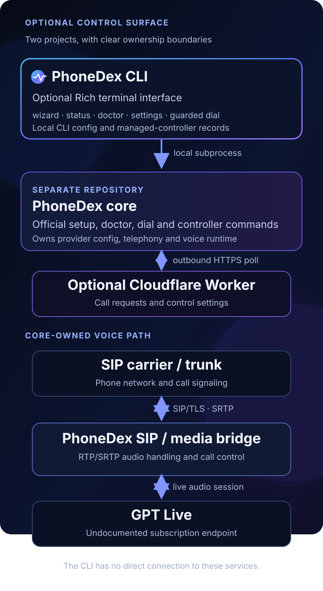

# Architecture and privacy

PhoneDex CLI is a local terminal frontend for the separate PhoneDex core. It does not implement a SIP stack and does not make direct network connections to a carrier, GPT Live or Cloudflare Worker. Its integration boundary is the core's documented command line.

## Checkout selection

The core checkout is resolved in this order:

1. `--checkout PATH` on the command line.
2. `PHONEDEX_HOME` in the environment.
3. The checkout path saved by the CLI wizard.

The CLI validates that a checkout contains `phonedex.py`, `onboarding.py` and `scripts/bootstrap.py`. The clone option uses only the official public PhoneDex repository and refuses to overwrite an existing destination.

## Local files

The CLI stores its own preference and controller files outside the PhoneDex checkout:

| File | Purpose |
| --- | --- |
| `config.json` | Selected PhoneDex source path. |
| `controller.json` | PID, process creation time, script path and checkout for the controller started by this CLI. |
| `controller.log` | Output from that CLI-managed controller. It can contain call metadata. |

On Windows, the default directory is `%APPDATA%\PhoneDexCLI`. On macOS and Linux it is `$XDG_CONFIG_HOME/phonedex-cli`, falling back to `~/.config/phonedex-cli`. Set `PHONEDEX_CLI_HOME` to choose a different directory.

PhoneDex's `.env`, Python virtual environment, transcript database and any Worker configuration remain owned by the core project.

## Command and process boundaries

- `wizard` can delegate bootstrap, Codex login, the core setup wizard and diagnostics, each behind its own prompt.
- `doctor` runs the core's setup readiness check and read-only runtime doctor. It does not provision networking or deploy a Worker.
- `settings` edits only four supported non-credential `.env` entries: transcript mode, local retention days, daily call limit and allowed recipient numbers. It preserves unrelated lines, validates values, and refuses symlink writes. Recipient numbers remain private data.
- `dial` validates an E.164 recipient against `PHONEDEX_ALLOWED_RECIPIENTS` and limits duration to 20–300 seconds. It is a dry run unless `--place-call` is supplied. Live calls require an interactive confirmation unless `--yes` is explicitly used; the allowlist and core checks still apply.
- `start` and `restart` ask before starting the controller. A running controller may dispatch call requests already queued in a configured Worker.
- `stop` only terminates a process whose PID, creation time, script path and checkout match the CLI's record. It does not force-kill a process that fails to stop cleanly.

The CLI does not store SIP passwords or Codex tokens. Its editor reads and writes only the four listed settings, while the core setup handles provider credentials. On POSIX, CLI-managed files are written with owner-only permissions; on Windows they inherit the user's local ACLs.

## Data and limitations

Transcript storage defaults to `off` in the core. The `worker` and `both` modes send transcript text to the user's configured Worker/KV after confirmation. Changing the mode affects new calls and does not delete old transcript data.

The CLI's log viewer replaces lines containing common secret labels, but it does not redact phone numbers or call content. Treat controller logs as private data.

The PhoneDex core currently uses an undocumented GPT Live subscription endpoint. Access, authorization and compatibility are outside this CLI's control and may change. The CLI and core are experimental and are not affiliated with OpenAI, Codex or AgentPhone.
